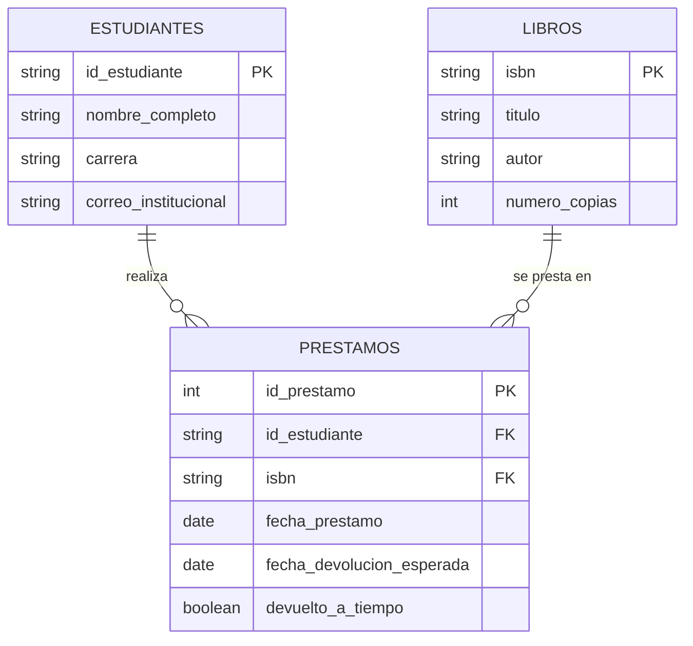
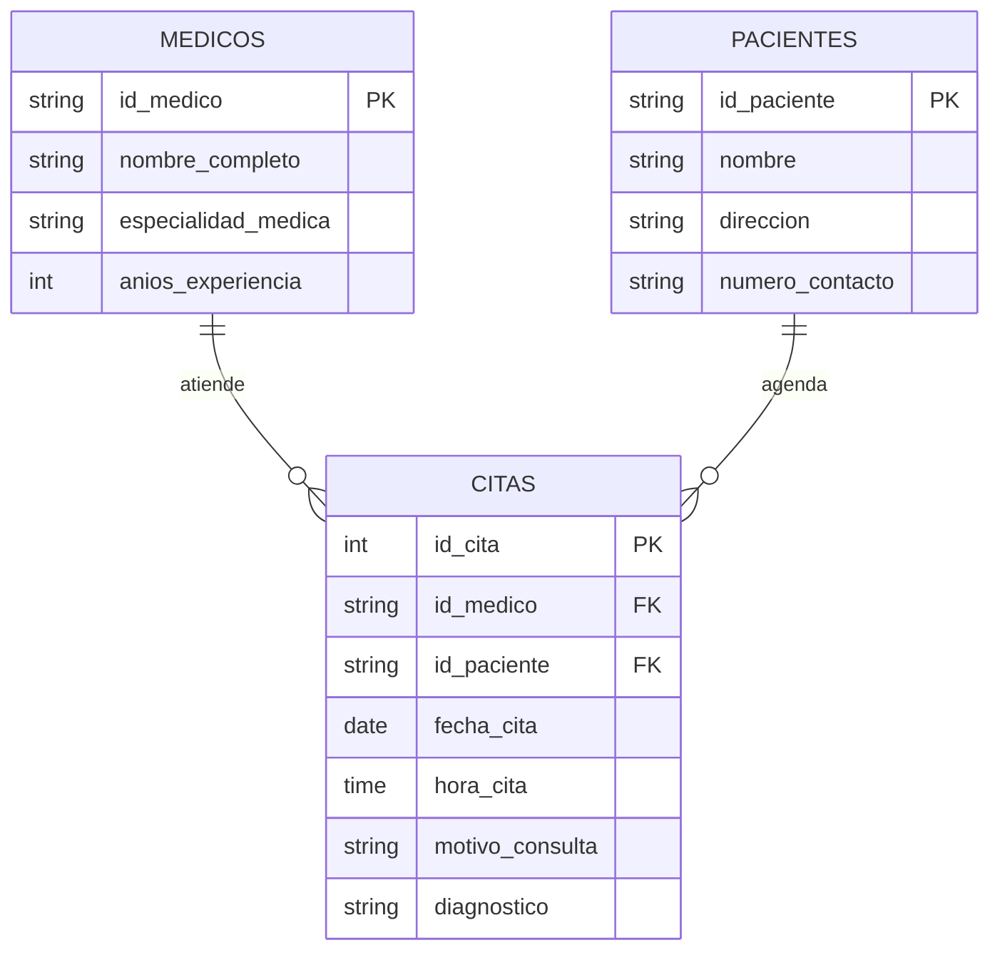
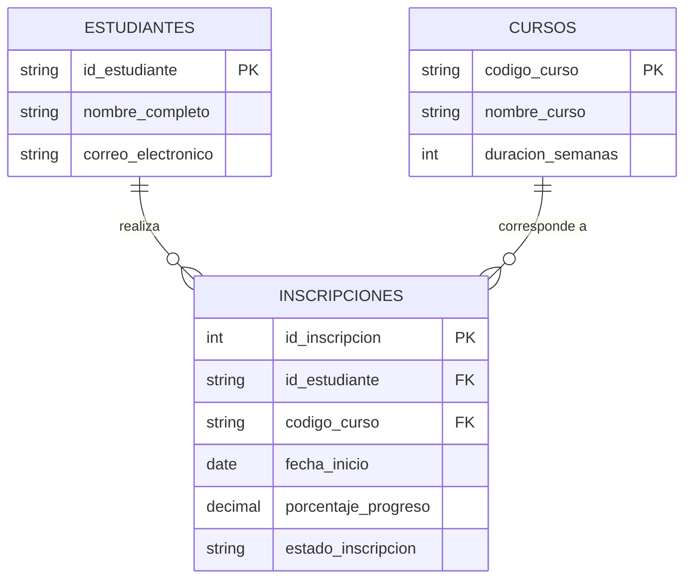
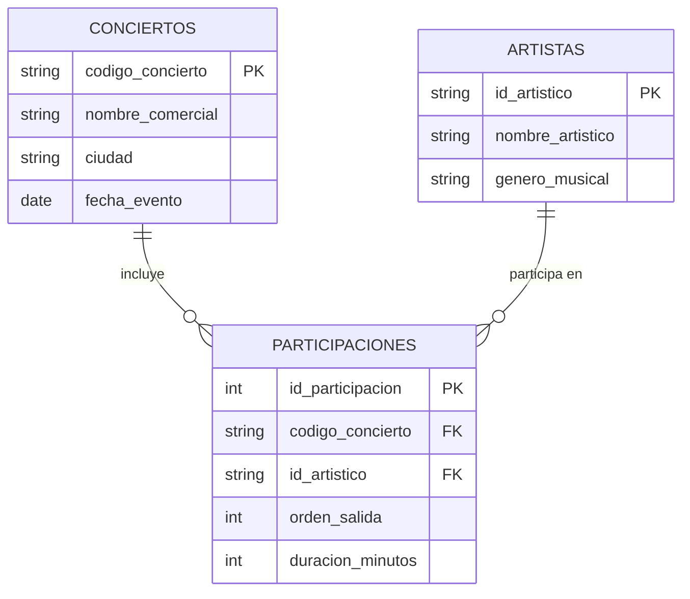

# postgres-db-practicas-gen

**Modelado de bases de datos: Diagrama Entidad-Relación (DER) y Modelo Relacional**

Laboratorio práctico del **Bootcamp Full Stack Java Jr. — Generation Colombia**, en el que se analizan cuatro escenarios de negocio reales y se construyen, para cada uno, el diagrama conceptual (DER) y su transformación al modelo relacional (lógico) utilizando **draw.io (diagrams.net)**. El diseño está orientado a una posterior implementación en **PostgreSQL**.

> Documento fuente del laboratorio: [`Laboratorio Práctico - DER y Modelo Relacional.pdf`](./Laboratorio%20Pr%C3%A1ctico%20-%20DER%20y%20Modelo%20Relacional.pdf)

---

## Tabla de contenidos

- [Descripción](#descripción)
- [Objetivos de aprendizaje](#objetivos-de-aprendizaje)
- [Estructura del repositorio](#estructura-del-repositorio)
- [Requisitos y herramientas](#requisitos-y-herramientas)
- [Cómo abrir los diagramas](#cómo-abrir-los-diagramas)
- [Convenciones de modelado aplicadas](#convenciones-de-modelado-aplicadas)
- [Ejercicio 1: Biblioteca universitaria](#ejercicio-1-biblioteca-universitaria)
- [Ejercicio 2: Clínica médica Salud](#ejercicio-2-clínica-médica-salud)
- [Ejercicio 3: Plataforma de cursos en línea](#ejercicio-3-plataforma-de-cursos-en-línea)
- [Ejercicio 4: Organización de eventos](#ejercicio-4-organización-de-eventos)
- [Diagramas en Mermaid (vista relacional)](#diagramas-en-mermaid-vista-relacional)
- [Respuestas a las preguntas obligatorias (punto 7)](#respuestas-a-las-preguntas-obligatorias-punto-7)
- [Criterios de evaluación y autoverificación](#criterios-de-evaluación-y-autoverificación)
- [Entregable esperado](#entregable-esperado)
- [Notas sobre los nombres de los atributos](#notas-sobre-los-nombres-de-los-atributos)
- [Créditos](#créditos)

---

## Descripción

Antes de escribir una sola línea de SQL en PostgreSQL, todo ingeniero de software debe traducir las necesidades de una organización en una estructura de datos sólida, sin redundancias ni ambigüedades. Un error en la etapa de diseño genera datos duplicados, registros huérfanos y fallos críticos cuando la aplicación sale a producción.

Este repositorio contiene la solución del laboratorio práctico, en el que se modelan cuatro escenarios:

1. **Biblioteca universitaria** — préstamos de libros a estudiantes.
2. **Clínica médica Salud** — citas médicas entre pacientes y médicos.
3. **Plataforma de cursos en línea** — inscripciones de estudiantes a cursos.
4. **Organización de eventos** — participación de artistas en conciertos.

Para cada escenario se identifican entidades, atributos, claves primarias (PK), claves foráneas (FK), cardinalidades y, cuando aplica, entidades asociativas para resolver relaciones muchos a muchos (N:M).

## Objetivos de aprendizaje

- Extraer entidades fuertes, atributos descriptivos y reglas de negocio a partir de enunciados funcionales.
- Determinar correctamente las cardinalidades entre entidades (1:1, 1:N y N:M).
- Resolver relaciones N:M mediante entidades asociativas / tablas intermedias con atributos propios.
- Traducir un diagrama conceptual (DER) a un esquema relacional con PK, FK y convenciones `snake_case`.

## Estructura del repositorio

```text
postgres-db-practicas-gen/
├── README.md
├── Laboratorio Práctico - DER y Modelo Relacional.pdf
├── ejercicio1/
│   └── ejercicio1.drawio
├── ejercicio2/
│   └── ejercicio2.drawio
├── ejercicio3/
│   └── ejercicio_3.drawio
└── ejercicio4/
    └── ejercicio_4_organizacion_eventos.drawio
```

| Carpeta / Archivo | Contenido |
|---|---|
| `README.md` | Documentación del proyecto y de los modelos. |
| `Laboratorio Práctico - DER y Modelo Relacional.pdf` | Enunciado oficial del laboratorio (contexto, reglas de negocio, criterios de evaluación). |
| `ejercicio1/ejercicio1.drawio` | DER + modelo relacional de la biblioteca universitaria. |
| `ejercicio2/ejercicio2.drawio` | DER + modelo relacional de la clínica médica. |
| `ejercicio3/ejercicio_3.drawio` | DER + modelo relacional de la plataforma de cursos. |
| `ejercicio4/ejercicio_4_organizacion_eventos.drawio` | DER + modelo relacional de la organización de eventos. |

## Requisitos y herramientas

- **draw.io / diagrams.net** (web o aplicación de escritorio) para abrir y editar los archivos `.drawio`.
- **PostgreSQL 14+** (opcional, para implementar los scripts DDL propuestos en este README).
- **Git** (opcional, para clonar el repositorio).

No se requiere instalación de dependencias: el repositorio es documental (diagramas + documentación).

## Cómo abrir los diagramas

1. Ingresa a [app.diagrams.net](https://app.diagrams.net) o abre la aplicación de escritorio de draw.io.
2. Selecciona **File → Open from → Device** (o arrastra el archivo `.drawio` a la ventana).
3. Abre el archivo correspondiente a cada ejercicio.

En cada archivo se presentan, lado a lado, el **DER (conceptual)** y el **Modelo Relacional (lógico)**, siguiendo la correspondencia visual definida en el laboratorio.

## Convenciones de modelado aplicadas

| Concepto | Representación en DER | Representación en Modelo Relacional |
|---|---|---|
| Entidad / Tabla | Rectángulo con nombre claro | Tabla con encabezado en `snake_case` y filas de columnas |
| Atributo / Columna | Óvalo conectado a su entidad | Fila con nombre en `snake_case`, obligatoriedad y unicidad |
| Relación | Rombo con verbo de acción | Línea conectora con notación pata de gallo (Crow's Foot) |
| Claves (PK/FK) | Atributo identificador subrayado | Prefijo explícito `PK` / `FK` |

Regla clave aplicada en todos los casos N:M con atributos propios: la relación se convierte en una **tabla intermedia** que hereda las FK de ambas entidades y almacena sus propios atributos.

Convenciones de nombres:

- Tablas y columnas en `snake_case`.
- Claves primarias con prefijo `id_` o código natural cuando es un identificador de negocio (`isbn`, `codigo_curso`, `codigo_concierto`).
- Claves foráneas con el mismo nombre que la PK a la que referencian.
- Atributos booleanos con prefijo de significado (`devuelto_a_tiempo`).

---

## Ejercicio 1: Biblioteca universitaria

**Archivo:** [`ejercicio1/ejercicio1.drawio`](./ejercicio1/ejercicio1.drawio)

### Contexto

La Biblioteca Central digitaliza su sistema de préstamos. Cada libro tiene título, autor, ISBN único y número de copias disponibles. Los estudiantes tienen ID estudiantil, nombre completo, carrera y correo institucional.

### Reglas de negocio

- Un estudiante puede pedir prestado varios libros diferentes, incluso el mismo libro en distintas fechas.
- Un libro puede ser prestado a muchos estudiantes diferentes.
- Un mismo libro **no** puede ser prestado más de una vez a la misma persona en el mismo momento.

### Entidades y atributos

**Estudiantes (`estudiantes`)**

| Atributo (draw.io) | Columna | Tipo sugerido | Restricciones |
|---|---|---|---|
| `Estudiantes_ID` | `id_estudiante` | `VARCHAR(20)` | PK |
| `Nombre_completo` | `nombre_completo` | `VARCHAR(120)` | NOT NULL |
| `Carrera_estudiante` | `carrera` | `VARCHAR(80)` | NOT NULL |
| `Correo_estudiante` | `correo_institucional` | `VARCHAR(120)` | NOT NULL, UNIQUE |

**Libros (`libros`)**

| Atributo (draw.io) | Columna | Tipo sugerido | Restricciones |
|---|---|---|---|
| `ISBN_Iibros` | `isbn` | `VARCHAR(20)` | PK |
| `titulo_libro` | `titulo` | `VARCHAR(200)` | NOT NULL |
| `Nombre_autor` | `autor` | `VARCHAR(120)` | NOT NULL |
| `Numero_copias` | `numero_copias` | `INTEGER` | NOT NULL, CHECK (>= 0) |

**Préstamo (`prestamos`) — tabla intermedia N:M**

| Atributo (draw.io) | Columna | Tipo sugerido | Restricciones |
|---|---|---|---|
| `Prestamo_ID` | `id_prestamo` | `SERIAL` | PK |
| `FK Estudiantes_ID` | `id_estudiante` | `VARCHAR(20)` | FK → `estudiantes`, NOT NULL |
| `FK ISBN_Iibros` | `isbn` | `VARCHAR(20)` | FK → `libros`, NOT NULL |
| `prestamo_fecha` | `fecha_prestamo` | `DATE` | NOT NULL |
| `Devolucion_esperada` | `fecha_devolucion_esperada` | `DATE` | NOT NULL |
| `Devolvio_a_tiempo` | `devuelto_a_tiempo` | `BOOLEAN` | NOT NULL |

### Cardinalidades

- `estudiantes` **1:N** `prestamos`
- `libros` **1:N** `prestamos`
- La relación original estudiante–libro es **N:M** y se resuelve con la tabla `prestamos`.

### Script DDL (PostgreSQL)

```sql
CREATE TABLE estudiantes (
    id_estudiante           VARCHAR(20) PRIMARY KEY,
    nombre_completo         VARCHAR(120) NOT NULL,
    carrera                 VARCHAR(80)  NOT NULL,
    correo_institucional    VARCHAR(120) NOT NULL UNIQUE
);

CREATE TABLE libros (
    isbn            VARCHAR(20) PRIMARY KEY,
    titulo          VARCHAR(200) NOT NULL,
    autor           VARCHAR(120) NOT NULL,
    numero_copias   INTEGER      NOT NULL CHECK (numero_copias >= 0)
);

CREATE TABLE prestamos (
    id_prestamo                 SERIAL PRIMARY KEY,
    id_estudiante               VARCHAR(20) NOT NULL REFERENCES estudiantes (id_estudiante),
    isbn                        VARCHAR(20) NOT NULL REFERENCES libros (isbn),
    fecha_prestamo              DATE        NOT NULL,
    fecha_devolucion_esperada   DATE        NOT NULL,
    devuelto_a_tiempo           BOOLEAN     NOT NULL,
    CHECK (fecha_devolucion_esperada >= fecha_prestamo),
    UNIQUE (id_estudiante, isbn, fecha_prestamo)
);
```

---

## Ejercicio 2: Clínica médica Salud

**Archivo:** [`ejercicio2/ejercicio2.drawio`](./ejercicio2/ejercicio2.drawio)

### Contexto

La clínica registra las consultas médicas que ocurren entre pacientes y médicos. Cada médico tiene ID profesional, nombre completo, especialidad y años de experiencia. Cada paciente tiene ID, nombre, dirección y número de contacto.

### Reglas de negocio

- Un médico puede atender a muchos pacientes.
- Un paciente puede tener múltiples citas con uno o varios médicos distintos.
- Una cita siempre ocurre entre un solo médico y un solo paciente.
- Cada cita debe tener todos los datos registrados, sin excepción.

### Entidades y atributos

**Médicos (`medicos`)**

| Atributo (draw.io) | Columna | Tipo sugerido | Restricciones |
|---|---|---|---|
| `Medico_ID` | `id_medico` | `VARCHAR(20)` | PK |
| `Nombre_completo` | `nombre_completo` | `VARCHAR(120)` | NOT NULL |
| `Especialidad_medica` | `especialidad_medica` | `VARCHAR(80)` | NOT NULL |
| `Años_exp` | `anios_experiencia` | `INTEGER` | NOT NULL, CHECK (>= 0) |

**Pacientes (`pacientes`)**

| Atributo (draw.io) | Columna | Tipo sugerido | Restricciones |
|---|---|---|---|
| `ID_paciente` | `id_paciente` | `VARCHAR(20)` | PK |
| `Nombre_paciente` | `nombre` | `VARCHAR(120)` | NOT NULL |
| `Direccion_paciente` | `direccion` | `VARCHAR(200)` | NOT NULL |
| `Numero_contrato` | `numero_contacto` | `VARCHAR(30)` | NOT NULL |

**Cita (`citas`) — tabla intermedia N:M**

| Atributo (draw.io) | Columna | Tipo sugerido | Restricciones |
|---|---|---|---|
| `Registro_cita` (PK) | `id_cita` | `SERIAL` | PK |
| `FK Medico_ID` | `id_medico` | `VARCHAR(20)` | FK → `medicos`, NOT NULL |
| `FK ID_paciente` | `id_paciente` | `VARCHAR(20)` | FK → `pacientes`, NOT NULL |
| `Cita_fecha` | `fecha_cita` | `DATE` | NOT NULL |
| `Hora_cita` | `hora_cita` | `TIME` | NOT NULL |
| `Motivo_consutlta` | `motivo_consulta` | `TEXT` | NOT NULL |
| `Diagnostico_medico_a_paciente` | `diagnostico` | `TEXT` | NOT NULL |

### Cardinalidades

- `medicos` **1:N** `citas`
- `pacientes` **1:N** `citas`
- La relación original médico–paciente es **N:M** y se resuelve con la tabla `citas`.

### Script DDL (PostgreSQL)

```sql
CREATE TABLE medicos (
    id_medico           VARCHAR(20) PRIMARY KEY,
    nombre_completo     VARCHAR(120) NOT NULL,
    especialidad_medica VARCHAR(80)  NOT NULL,
    anios_experiencia   INTEGER      NOT NULL CHECK (anios_experiencia >= 0)
);

CREATE TABLE pacientes (
    id_paciente     VARCHAR(20)  PRIMARY KEY,
    nombre          VARCHAR(120) NOT NULL,
    direccion       VARCHAR(200) NOT NULL,
    numero_contacto VARCHAR(30)  NOT NULL
);

CREATE TABLE citas (
    id_cita         SERIAL PRIMARY KEY,
    id_medico       VARCHAR(20) NOT NULL REFERENCES medicos (id_medico),
    id_paciente     VARCHAR(20) NOT NULL REFERENCES pacientes (id_paciente),
    fecha_cita      DATE        NOT NULL,
    hora_cita       TIME        NOT NULL,
    motivo_consulta TEXT        NOT NULL,
    diagnostico     TEXT        NOT NULL,
    UNIQUE (id_medico, id_paciente, fecha_cita, hora_cita)
);
```

---

## Ejercicio 3: Plataforma de cursos en línea

**Archivo:** [`ejercicio3/ejercicio_3.drawio`](./ejercicio3/ejercicio_3.drawio)

### Contexto

Plataforma educativa donde los estudiantes se inscriben en cursos virtuales. Cada estudiante tiene ID único, nombre completo y correo electrónico. Cada curso tiene código, nombre y duración en semanas.

### Reglas de negocio

- Un estudiante puede estar inscrito en varios cursos al mismo tiempo.
- Un curso puede tener muchos estudiantes inscritos.
- Cada inscripción se realiza entre un estudiante y un curso específico, y **no puede repetirse** si ya está activa o completada.

### Entidades y atributos

**Estudiantes (`estudiantes`)**

| Atributo (draw.io) | Columna | Tipo sugerido | Restricciones |
|---|---|---|---|
| `Estudiante_ID (PK)` | `id_estudiante` | `VARCHAR(20)` | PK |
| `Nombre_completo` | `nombre_completo` | `VARCHAR(120)` | NOT NULL |
| `Correo_electronico` | `correo_electronico` | `VARCHAR(120)` | NOT NULL, UNIQUE |

**Cursos (`cursos`)**

| Atributo (draw.io) | Columna | Tipo sugerido | Restricciones |
|---|---|---|---|
| `Codigo_curso (PK)` | `codigo_curso` | `VARCHAR(20)` | PK |
| `Nombre_curso` | `nombre_curso` | `VARCHAR(120)` | NOT NULL |
| `Duracion_semanas` | `duracion_semanas` | `INTEGER` | NOT NULL, CHECK (> 0) |

**Inscripción (`inscripciones`) — tabla intermedia N:M**

| Atributo (draw.io) | Columna | Tipo sugerido | Restricciones |
|---|---|---|---|
| `Inscripcion_ID (PK)` | `id_inscripcion` | `SERIAL` | PK |
| `Estudiante_ID (FK)` | `id_estudiante` | `VARCHAR(20)` | FK → `estudiantes`, NOT NULL |
| `Codigo_curso (FK)` | `codigo_curso` | `VARCHAR(20)` | FK → `cursos`, NOT NULL |
| `Fecha_inicio` | `fecha_inicio` | `DATE` | NOT NULL |
| `Porcentaje_progreso` | `porcentaje_progreso` | `NUMERIC(5,2)` | NOT NULL, CHECK (0–100) |
| `Estado_inscripcion` | `estado_inscripcion` | `VARCHAR(15)` / ENUM | NOT NULL, CHECK (valores válidos) |

### Cardinalidades

- `estudiantes` **1:N** `inscripciones`
- `cursos` **1:N** `inscripciones`
- La relación original estudiante–curso es **N:M** y se resuelve con la tabla `inscripciones`.

### Script DDL (PostgreSQL)

```sql
CREATE TYPE estado_inscripcion AS ENUM ('activo', 'completado', 'abandonado');

CREATE TABLE estudiantes (
    id_estudiante       VARCHAR(20)  PRIMARY KEY,
    nombre_completo     VARCHAR(120) NOT NULL,
    correo_electronico  VARCHAR(120) NOT NULL UNIQUE
);

CREATE TABLE cursos (
    codigo_curso      VARCHAR(20)  PRIMARY KEY,
    nombre_curso      VARCHAR(120) NOT NULL,
    duracion_semanas  INTEGER      NOT NULL CHECK (duracion_semanas > 0)
);

CREATE TABLE inscripciones (
    id_inscripcion       SERIAL PRIMARY KEY,
    id_estudiante        VARCHAR(20)          NOT NULL REFERENCES estudiantes (id_estudiante),
    codigo_curso         VARCHAR(20)          NOT NULL REFERENCES cursos (codigo_curso),
    fecha_inicio         DATE                 NOT NULL,
    porcentaje_progreso  NUMERIC(5,2)         NOT NULL CHECK (porcentaje_progreso BETWEEN 0 AND 100),
    estado_inscripcion   estado_inscripcion   NOT NULL DEFAULT 'activo'
);

-- No se permite repetir una inscripción activa o completada para el mismo
-- estudiante y curso; sí se permite reintentar si la anterior fue abandonada.
CREATE UNIQUE INDEX ux_inscripcion_activa_completada
    ON inscripciones (id_estudiante, codigo_curso)
    WHERE estado_inscripcion IN ('activo', 'completado');
```

---

## Ejercicio 4: Organización de eventos

**Archivo:** [`ejercicio4/ejercicio_4_organizacion_eventos.drawio`](./ejercicio4/ejercicio_4_organizacion_eventos.drawio)

### Contexto

Una productora organiza conciertos en diferentes ciudades. Cada concierto tiene código único, nombre comercial, ciudad y fecha. Los artistas invitados tienen ID artístico, nombre artístico y género musical.

### Reglas de negocio

- En un mismo concierto pueden presentarse varios artistas.
- Un mismo artista puede presentarse en muchos conciertos distintos.
- Un artista **no** puede presentarse dos veces dentro del mismo concierto.
- Cada participación registrada debe incluir siempre el orden de salida y la duración de la actuación.

### Entidades y atributos

**Conciertos (`conciertos`)**

| Atributo (draw.io) | Columna | Tipo sugerido | Restricciones |
|---|---|---|---|
| `Codigo_concierto (PK)` | `codigo_concierto` | `VARCHAR(20)` | PK |
| `Nombre_comercial` | `nombre_comercial` | `VARCHAR(120)` | NOT NULL |
| `Ciudad` | `ciudad` | `VARCHAR(80)` | NOT NULL |
| `Fecha_evento` | `fecha_evento` | `DATE` | NOT NULL |

**Artistas (`artistas`)**

| Atributo (draw.io) | Columna | Tipo sugerido | Restricciones |
|---|---|---|---|
| `ID_artistico (PK)` | `id_artistico` | `VARCHAR(20)` | PK |
| `Nombre_artistico` | `nombre_artistico` | `VARCHAR(120)` | NOT NULL |
| `Genero_musical` | `genero_musical` | `VARCHAR(60)` | NOT NULL |

**Participación (`participaciones`) — tabla intermedia N:M**

| Atributo (draw.io) | Columna | Tipo sugerido | Restricciones |
|---|---|---|---|
| `Participacion_ID (PK)` | `id_participacion` | `SERIAL` | PK |
| `Codigo_concierto (FK)` | `codigo_concierto` | `VARCHAR(20)` | FK → `conciertos`, NOT NULL |
| `ID_artistico (FK)` | `id_artistico` | `VARCHAR(20)` | FK → `artistas`, NOT NULL |
| `Orden_salida` | `orden_salida` | `INTEGER` | NOT NULL, CHECK (> 0) |
| `Duracion_minutos` | `duracion_minutos` | `INTEGER` | NOT NULL, CHECK (> 0) |

### Cardinalidades

- `conciertos` **1:N** `participaciones`
- `artistas` **1:N** `participaciones`
- La relación original concierto–artista es **N:M** y se resuelve con la tabla `participaciones`.

### Script DDL (PostgreSQL)

```sql
CREATE TABLE conciertos (
    codigo_concierto  VARCHAR(20)  PRIMARY KEY,
    nombre_comercial  VARCHAR(120) NOT NULL,
    ciudad            VARCHAR(80)  NOT NULL,
    fecha_evento      DATE         NOT NULL
);

CREATE TABLE artistas (
    id_artistico      VARCHAR(20)  PRIMARY KEY,
    nombre_artistico  VARCHAR(120) NOT NULL,
    genero_musical    VARCHAR(60)  NOT NULL
);

CREATE TABLE participaciones (
    id_participacion  SERIAL PRIMARY KEY,
    codigo_concierto  VARCHAR(20) NOT NULL REFERENCES conciertos (codigo_concierto),
    id_artistico      VARCHAR(20) NOT NULL REFERENCES artistas (id_artistico),
    orden_salida      INTEGER     NOT NULL CHECK (orden_salida > 0),
    duracion_minutos  INTEGER     NOT NULL CHECK (duracion_minutos > 0),
    UNIQUE (codigo_concierto, id_artistico)
);
```

---

## Diagramas en Mermaid (vista relacional)

Vista relacional resumida de los cuatro modelos, renderizable directamente en GitHub.

### Ejercicio 1 — Biblioteca



### Ejercicio 2 — Clínica



### Ejercicio 3 — Plataforma de cursos



### Ejercicio 4 — Organización de eventos



---

## Respuestas a las preguntas obligatorias (punto 7)

### 1. Claves primarias compuestas vs. identificador propio (Ejercicio 1 — Préstamos)

**Pregunta:** Dado que un estudiante puede pedir el mismo libro en distintas fechas, ¿por qué conviene agregar un identificador propio (`id_prestamo`) o incluir la fecha de préstamo dentro de la clave de la tabla intermedia?

**Respuesta:** La tabla `prestamos` representa eventos de préstamo, no una simple relación estática. Si la PK fuera únicamente `(id_estudiante, isbn)`, cada estudiante podría tener **un solo préstamo por libro en toda su historia**, lo que contradice la regla de negocio (re-préstamos en distintas fechas). Por eso se agregó la PK sustituta `id_prestamo`, que identifica cada evento de préstamo de forma única y permite múltiples préstamos del mismo libro por el mismo estudiante. Como alternativa equivalente, la PK compuesta `(id_estudiante, isbn, fecha_prestamo)` también garantiza unicidad por evento. Adicionalmente, la restricción `UNIQUE (id_estudiante, isbn, fecha_prestamo)` evita registrar el mismo préstamo dos veces en la misma fecha, cubriendo la regla "un mismo libro no puede ser prestado más de una vez a la misma persona en el mismo momento".

### 2. Control de valores permitidos (Ejercicio 3 — Inscripciones)

**Pregunta:** ¿Cómo se aseguró en el Modelo Relacional que el estado de la inscripción registre únicamente los tres estados válidos (activo, completado, abandonado) y por qué es importante definirlo desde el diseño?

**Respuesta:** Se definió el tipo `estado_inscripcion` como `ENUM ('activo', 'completado', 'abandonado')` en PostgreSQL (alternativa equivalente: `VARCHAR` con restricción `CHECK (estado_inscripcion IN (...))`). De este modo, la base de datos **rechaza automáticamente** cualquier valor distinto a los tres permitidos, incluso si la aplicación cliente no valida los datos. Definirlo desde el diseño es importante porque centraliza la regla de negocio en el esquema, evita estados inválidos o inconsistentes, simplifica las consultas y reportes (filtros exactos) y protege la integridad de los datos frente a errores de aplicación o cargas masivas.

### 3. Regla de no repetición en tablas asociativas (Ejercicio 4 — Organización de eventos)

**Pregunta:** ¿Cómo se garantiza en el diseño relacional que un mismo artista no sea programado dos veces en el mismo concierto sin impedir que participe en otros conciertos distintos?

**Respuesta:** En la tabla `participaciones` se definió la restricción `UNIQUE (codigo_concierto, id_artistico)`. Esta restricción actúa **solo sobre la combinación** concierto+artista: impide duplicar la participación de un artista en un mismo concierto, pero permite que ese mismo artista aparezca en filas distintas con otros `codigo_concierto`. De esta forma se preserva la relación N:M (un artista en muchos conciertos; un concierto con muchos artistas) sin perder integridad. El identificador propio `id_participacion` se mantiene para referenciar cada participación de forma unívoca.

---

## Criterios de evaluación y autoverificación

| # | Criterio | Indicador de logro esperado | Estado |
|---|---|---|---|
| 1 | Entidades y atributos | Todos los atributos solicitados están ubicados en la entidad o tabla intermedia correcta, sin mezclar datos de otras entidades. | ☑ |
| 2 | Claves primarias y foráneas | Cada tabla tiene una PK claramente identificada y las tablas intermedias incluyen las FK hacia las entidades que conectan. | ☑ |
| 3 | Cardinalidades y tablas asociativas | Las relaciones N:M están correctamente descompuestas en dos relaciones 1:N mediante entidades asociativas con sus atributos propios. | ☑ |
| 4 | Entrega y justificación (punto 7) | El documento de entrega contiene las capturas de los 4 ejercicios y responde de forma argumentada a las tres preguntas obligatorias. | ☑ |

## Entregable esperado

Según el laboratorio, el entregable es un **documento Word** que contenga:

- Capturas de pantalla legibles de los 4 ejercicios en draw.io (DER a la izquierda y Modelo Relacional a la derecha).
- Respuestas justificadas a las tres preguntas obligatorias del punto 7.

Este repositorio aporta los diagramas fuente (`.drawio`) y la documentación técnica (este `README`), que puede servir de base para armar dicho documento.

## Notas sobre los nombres de los atributos

Los archivos `.drawio` conservan las etiquetas originales del laboratorio, que en algunos casos incluyen prefijos de entidad o erratas tipográficas (por ejemplo, `ISBN_Iibros`, `Parciente_clinica`, `Numero_contrato`, `Motivo_consutlta`). En esta documentación y en los scripts DDL se normalizan a `snake_case` canónico (`isbn`, `pacientes`, `numero_contacto`, `motivo_consulta`) para mantener consistencia con las convenciones de PostgreSQL. La correspondencia atributo-por-atributo se detalla en las tablas de cada ejercicio.

## Créditos

- Laboratorio diseñado por **Natalia Díaz** — Diseñadora UX/UI e Instructora, Generation Colombia.
- Repositorio: práctica individual del Bootcamp Full Stack Java Jr.
